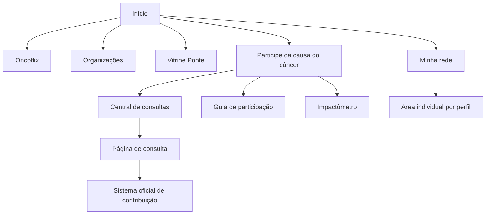

# OncoPontes — proposta de evolução

**Para validação · 26/11/2026.** Esta proposta não altera o site publicado. Ela organiza a evolução em etapas, mantendo a identidade visual e os fluxos que já funcionam.

## 1. Ponto de partida

| Já existe | Situação encontrada |
| --- | --- |
| Página inicial e identidade visual | Composição editorial, fotografia, roxo profundo, verde petróleo, Manrope e caminhos para educação, organizações e rede. |
| Oncoflix | Quatro jornadas fictícias com aulas, atividade e progresso por perfil; página pública independente. |
| Organizações | Diretório pesquisável, filtros de serviços e localização, perfil público com aprovação e autorização demonstrativas. |
| Vitrine Ponte | Páginas de projetos, profissionais e empreendedores. |
| Minha área | Login e cadastro de teste, perfis específicos, progresso de aprendizagem e projetos demonstrativos. |
| Administração | Análise demonstrativa de organizações, projetos e intermediação no navegador. |

**Lacunas para esta rodada:** não existe central de consultas, página individual de consulta, guia de participação, registro voluntário, Impactômetro, favoritos ou acompanhamento de consultas. A navegação pública ainda conduz “participar da rede” ao cadastro. As métricas globais e as permissões reais dependem de API e banco de dados; o protótipo atual usa `sessionStorage` e `localStorage`.

**Pontos a preservar:** cadastro da ONG em sete etapas, diagnóstico privado, projetos, diretório e seus filtros, Vitrine Ponte, nomes Oncoflix e Vitrine Ponte, jornadas e progresso, áreas por perfil e fluxo administrativo existente. O CNPJ já não é obrigatório no formulário demonstrativo e continuará opcional para iniciativas sem esse registro.

## 2. Posicionamento e navegação

**Título da página inicial:** “Rede de conhecimento, conexões e oportunidades na oncologia.”

**Texto de apoio:** usar o texto enviado pela cliente como base editorial, com revisão de legibilidade antes da publicação. Não mudar conteúdos aprovados de páginas internas nesta etapa.

| Navegação pública proposta | Destino | Precisa entrar? |
| --- | --- | --- |
| Aprenda sobre câncer | Oncoflix e conteúdos educativos existentes | Não |
| Encontre organizações | Diretório de ONGs e perfis institucionais | Não |
| Projetos e iniciativas | Vitrine Ponte e projetos públicos autorizados | Não |
| Participe da causa do câncer | Central, guia, consultas e Impactômetro | Não |
| Minha rede | Painel conforme perfil, histórico e itens salvos | Sim |

“Entrar” permanece como ação discreta no cabeçalho. O Oncoflix continua com nome próprio, dentro do caminho de educação. A mudança do rótulo “Aprender sobre o câncer” para “Aprenda sobre câncer” está proposta porque a orientação mais recente o solicita; esse rótulo fazia parte de uma definição anterior e deve ser validado antes de ser aplicado.



## 3. Organização visual

Preservar paleta, tipografia, fotografia e componentes atuais. A homepage muda de hierarquia, sem repetir um mesmo card para cada caminho:

```text
DESKTOP
┌ Marca · Aprenda · Organizações · Projetos · Participe · Minha rede ┐
│ Título institucional + texto enviado       │ Fotografia existente │
│ Ações: Explorar conteúdos · Ver consultas                          │
├ Faixa editorial: aprender / encontrar apoio / conhecer iniciativas ┤
├ Destaque de participação: consultas verificadas e guia             ┤
└ Vitrine Ponte + rodapé institucional                                ┘

MOBILE
Marca + menu → título → fotografia → ações → três caminhos em lista
→ participação → Vitrine → rodapé. Sem carrossel obrigatório.
```

Na área **Participe**, o topo apresenta a finalidade e explica que a contribuição acontece no órgão responsável. Abaixo vêm: busca e filtros; listas “Abertas”, “Encerradas” e “Resultados publicados”; um bloco de orientação; e o Impactômetro. Filtros: tema, órgão, status e período. Cada card mostra título, órgão, prazo verificado, status, resumo curto e data da última conferência. No celular, filtros ficam em um painel expansível e o prazo aparece antes da descrição.

Na **página de consulta**, a ordem é: título e status → órgão e prazo → resumo em linguagem simples → o que está em discussão e por que importa → quem pode participar → documentos oficiais → passos para contribuir → link para o sistema oficial → compartilhamento → pergunta voluntária sobre participação → resultado oficial, quando publicado. O botão de contribuição permanece claramente identificado como saída para o ambiente oficial. Nenhum texto sugere uma posição ou uma resposta pronta.

## 4. Estrutura funcional por etapa

### Etapa 1 — Estrutura e experiência pública

- Ajustar título, texto de apoio e navegação da homepage, conservando a composição visual aprovada.
- Acrescentar `participar.html`, `consulta.html?id=...`, `guia-participacao.html` e `impacto.html` sem substituir páginas existentes.
- Publicar apenas consultas conferidas em páginas oficiais por uma pessoa da equipe. Cada registro terá fonte, URL oficial, data de verificação e estado editorial.
- Criar uma página modelo de consulta para revisão antes de incluir qualquer consulta real. Exemplos fictícios, se usados, serão identificados e não terão botão que aparente enviar contribuição.
- Compartilhar por recurso nativo do dispositivo, quando disponível, ou copiar o link público. Essa ação não contará como participação.
- Oferecer a pergunta voluntária sem login. Enquanto não houver servidor, a resposta ficará somente no navegador da pessoa e **não** entrará em indicador agregado.
- Mostrar no Impactômetro a definição de cada indicador e o estado “Ainda não medido” onde não houver coleta confiável. Não transformar valores de demonstração em números institucionais.
- No diretório, acrescentar necessidades e oportunidades de apoio somente quando cadastradas, autorizadas e aprovadas para exibição pública. Demandas privadas continuam fora da busca.

### Etapa 2 — Gestão, fontes e métricas

- Acrescentar ao painel administrativo existente cadastro, revisão, publicação, atualização e arquivamento de consultas, com histórico de decisões.
- Modelo de conteúdo separado de fonte: `consulta`, `fonte oficial`, `documento`, `resultado`, `revisão editorial`, `campanha`, `organização mobilizadora` e `evento de métrica`.
- Avaliar cada fonte oficial individualmente. Um coletor pode sugerir novos registros ou mudanças; a publicação exige revisão humana. IA só sugere classificação, resumo e duplicatas, sempre com URL e trecho de origem para conferência.
- Implementar API, banco de dados, autenticação administrativa e permissões por função antes de guardar dados reais ou publicar por painel.
- Registrar eventos distintos: visualização de página, clique no link oficial e autodeclaração. Participação verificada só será exibida quando houver confirmação confiável do órgão. Informar método, período, atraso e limitações no relatório.
- Links de campanha apontam para uma URL da OncoPontes com código de origem não pessoal. O redirecionamento ao órgão oficial remove esse código; acessos por origem são agregados no servidor.
- “Minha rede” poderá guardar consultas acompanhadas, oportunidades e organizações favoritas com uma conta real, sem exigir login para ver conteúdos públicos.

### Etapa 3 — Mobilização e sustentabilidade

- Incluir gestão de campanhas, organizações mobilizadoras e comunicadores, com autorização, responsabilidades e relatórios.
- Estruturar patrocínios e programas de formação em módulo separado da curadoria de consultas. Patrocínio nunca define inclusão, resumo ou orientação de participação.
- Prever Encontros OncoPontes com inscrições e consentimentos próprios; disponibilizar essa função apenas quando houver operação e política de dados aprovadas.

## 5. Modelo mínimo da consulta

```text
id, título, órgão, tema, tipo de oportunidade
URL da página oficial, URL oficial de contribuição, documentos oficiais
abertura, encerramento, fuso/horário conhecido, última verificação
resumo neutro, assunto em discussão, relevância, público apto a participar
orientações oficiais, estado editorial, status público, resultado oficial
responsável pela revisão, data da aprovação, histórico de alterações
```

Os estados editoriais são **rascunho → em revisão → publicada → arquivada**. O status público é **aberta, encerrada ou resultado publicado** e depende da fonte oficial, das datas e de revisão. Se o prazo ou o link oficial não puder ser confirmado, o registro não mostra um botão de contribuição ativo. Retificações e prorrogações precisam ser registradas no histórico.

## 6. Indicadores e privacidade

| Indicador | O que mede | Regra |
| --- | --- | --- |
| Acessos | Visitas à página da consulta | Não equivalem a pessoas únicas nem a contribuições. |
| Cliques oficiais | Saídas pelo link de contribuição | Não comprovam envio. |
| Participações autodeclaradas | Resposta voluntária “Sim, enviei” | Exibidas como autodeclaradas, sem identificação pessoal. |
| Participações verificadas | Confirmação por fonte confiável do órgão | Ausentes até existir método verificável. |
| Organizações e campanhas | Entidades e ações com participação registrada | Apenas com cadastro, autorização e critério de contagem definidos. |
| Resultados oficiais | Decisões publicadas pelo órgão | URL e data de publicação obrigatórias. |

Não coletar dados de saúde para leitura ou participação pública. O registro voluntário não pede nome, e-mail, laudo ou texto da contribuição. A futura coleta de acessos e cliques precisa de aviso claro, retenção definida e revisão de privacidade antes de entrar em operação.

## 7. Fontes oficiais e integração

- [Conitec — consultas públicas](https://www.gov.br/conitec/pt-br/assuntos/participacao-social/consultas-publicas): índice e documentos oficiais. A [página de consultas vigentes](https://www.gov.br/conitec/pt-br/assuntos/participacao-social/consultas-publicas/vigentes) direciona a contribuição ao Brasil Participativo.
- [Anvisa — participação social](https://www.gov.br/anvisa/pt-br/acessoainformacao/participacaosocial): mecanismos e páginas específicas; não confundir com o “Sistema de Consultas” de produtos.
- [Ministério da Saúde — consultas públicas](https://www.gov.br/saude/pt-br/acesso-a-informacao/participacao-social/consultas-publicas): índices de abertas e encerradas.

Essas páginas comprovam canais oficiais, mas **não comprovam uma API única de consultas**. Antes de automatizar, testar dados estruturados, permissões de uso, atualização, estabilidade dos links e qualidade de datas e status de cada origem. Onde a integração não for confiável, usar monitoramento e cadastro editorial manual.

## 8. Critérios de aceite da Etapa 1

1. Todas as páginas públicas abrem sem login e todos os links apontam para destinos reais.
2. A nova navegação funciona em desktop e celular, com teclado e foco visível; as rotas antigas continuam válidas.
3. Consulta publicada tem fonte oficial, prazo/status conferidos e revisão editorial identificável.
4. O link oficial abre a página correta do órgão; a OncoPontes não recebe contribuições em seu lugar.
5. Compartilhar e registrar resposta voluntária funcionam, mas métricas globais indisponíveis são apresentadas como tal.
6. Diretório, Oncoflix, áreas individuais e administração existentes passam pelos fluxos de regressão sem perda de dados demonstrativos.

## 9. Decisões para validação

1. Confirmar os cinco rótulos da navegação, em especial “Aprenda sobre câncer” frente ao nome anterior “Aprender sobre o câncer”.
2. Confirmar a organização visual da homepage, da central e da página individual antes de editar as telas.
3. Definir quem fará a primeira revisão editorial das consultas reais e aprovar o texto de apoio da homepage, que foi enviado como sugestão.

Com essas decisões, a implementação da Etapa 1 pode começar sem bloquear a análise técnica das fontes e do modelo de dados da Etapa 2.
